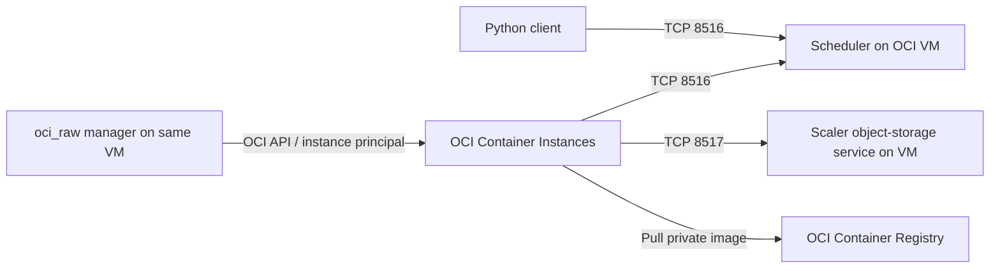

# OpenGRIS Scaler on OCI

[OpenGRIS](https://github.com/finos/opengris) is a FINOS initiative for making distributed compute resources easier to share across applications. Its scope covers a grid resource scheduling standard and a set of open-source Python libraries. Applications describe work to execute; an execution runtime schedules that work across local processes, servers, or cloud resources.

The motivation comes from a familiar problem in large financial institutions: different teams have separate compute pools, demand varies through the day, and capacity assigned to one application can sit idle while another application needs more. OpenGRIS aims to make those resources more accessible through common interfaces and flexible execution backends. This applies to batch calculations and interactive analysis, including Monte Carlo pricing and risk calculations. See the project's [scope and original FINOS proposal](https://github.com/finos/community/issues/326).

### Citi's role

**Citi was an originating contributor to OpenGRIS.** The [FINOS contribution and onboarding record](https://github.com/finos/community/issues/326) identifies Citi engineers as the initial maintainer and confirmed contributors, and records the open-source Scaler implementation under its original `github.com/citi/scaler` location. The project therefore brings contributions from engineers working on distributed-compute problems in banking into a FINOS community project.

The current OpenGRIS umbrella and the Scaler, ParGraph, and Parfun repositories are hosted under the FINOS GitHub organization, where development and collaboration take place openly. Citi's contribution is part of that history; this repository provides an independent OCI deployment example for those community components.

### The OpenGRIS packages

The three libraries address different parts of a parallel application:

| Component | Python distribution / import | Role | Example use |
|---|---|---|---|
| [Scaler](https://github.com/finos/opengris-scaler) | `opengris-scaler` / `scaler` | Executes distributed tasks through a client, scheduler, workers, and worker managers. The client submits work and retrieves results through futures. | Submit independent Monte Carlo partitions to workers running in OCI Container Instances. |
| [ParGraph](https://github.com/finos/opengris-pargraph) | `pargraph` / `pargraph` | Expresses calculations as dependency graphs. Its graph-building decorators and graph engine describe which tasks can run concurrently and which need earlier results. | Prepare market data, run independent valuations, then aggregate results once their inputs are ready. |
| [Parfun](https://github.com/finos/opengris-parfun) | `parfun` / `parfun` | Adds function-level parallelism using the `@parallel` decorator. The application defines how to split inputs and combine outputs in a map/reduce pattern. | Split a large input collection into batches, process the batches in parallel, and combine the results. |

**Scaler handles execution; ParGraph expresses dependencies; Parfun expresses how to split and combine function work.** ParGraph and Parfun can be used with suitable execution backends, including Scaler. They are optional application-level tools: a client can submit tasks directly to Scaler without either library.

For example, a Monte Carlo application can submit each independent partition directly with `Client.submit()`, use ParGraph to connect preparation, simulation, and aggregation stages, or use Parfun to describe partitioning and reduction around a function. These are application design choices rather than a requirement to install all three packages.

### How this repository runs OpenGRIS on OCI

This quickstart uses **Scaler directly**, with its `oci_raw` worker manager. ParGraph and Parfun are described here to explain the wider project; the included examples do not require or install them.

On Oracle Cloud Infrastructure (OCI), Scaler's **`oci_raw` worker manager** can create and delete **OCI Container Instances** as workload demand changes. One Compute VM runs the scheduler, the worker manager, and Scaler's object-storage service. Worker processes run inside the container instances and connect back to that VM over the private network. This setup needs no Kubernetes cluster. Scaler's object-storage service is its own process on TCP 8517; it is distinct from OCI Object Storage buckets.

This repository guides you from a new OCI VM to a working grid, then runs the European, Asian, digital, barrier, and market-risk examples from [oci-monte-carlo-quickstart](https://github.com/dezma/oci-monte-carlo-quickstart). It uses VM instance principals for OCI authentication and private OCIR images. It is a single-VM demonstration, with local result files; it does not configure scheduler high availability, authentication between Scaler clients/workers, or durable recovery after scheduler failure.



## 1. Create the scheduler VM and network

Use the OCI Console to create an **Oracle Linux 9 x86_64 VM**, for example `VM.Standard.E4.Flex` with 2 OCPUs and 16 GB RAM. Choose a compartment and subnet with space for the worker VNICs. Record the instance OCID. The generator later discovers the private IP, region, compartment, full availability-domain name, and subnet automatically.

Use an existing VCN or create one with appropriate routing. Workers default to the VM's subnet and compartment. The VM and workers need DNS and outbound HTTPS to OCI APIs, OCIR, Python package indexes, and Python/uv download hosts. A private subnet needs a NAT gateway or equivalent internet egress; a service gateway alone does not provide access to PyPI or GitHub. Confirm Container Instances quota and shape availability in your selected region and AD.

For SSH, use your organization's approved access method, such as OCI Bastion. In a FIPS environment generate an RSA key, for example `ssh-keygen -t rsa -b 3072`, rather than Ed25519.

Configure the VM's subnet security list or attached NSG:

| Destination | Source | Protocol / destination port |
|---|---|---|
| Scheduler VM | Worker subnet CIDR | TCP 8516 and 8517 |
| Scheduler VM | Approved SSH/Bastion source | TCP 22 |

Allow corresponding worker egress to the scheduler. Use stateful rules, or configure return traffic explicitly for stateless rules. Keep Scaler ports reachable only from trusted compute: TCP transport in this demo does not authenticate clients.

If `firewalld` runs on the scheduler, add matching host rules. Substitute your worker subnet CIDR and the active interface's zone (`sudo firewall-cmd --get-active-zones`):

```bash
WORKER_SUBNET_CIDR='172.16.0.0/24'  # replace with the actual worker subnet
FIREWALL_ZONE='public'              # replace if your interface uses another zone
sudo firewall-cmd --permanent --zone="$FIREWALL_ZONE" \
  --add-rich-rule="rule family=ipv4 source address=$WORKER_SUBNET_CIDR port port=8516-8517 protocol=tcp accept"
sudo firewall-cmd --reload
```

## 2. Clone this repository and install the environment

On the VM:

```bash
sudo dnf install -y git curl podman
git clone https://github.com/acoracle/opengris-oci-quickstart.git
cd opengris-oci-quickstart
bash scripts/install-environment.sh
source ~/scaler-py312/bin/activate
```

The installer installs uv if needed, obtains Python **3.12.15**, and creates `~/scaler-py312`. It installs `opengris-scaler[oci]==2.9.0` and `numpy==2.2.6`; Scaler's OCI extra supplies the compatible SDK. It does not depend on Oracle Linux's system Python or a C++ compiler when a compatible wheel is available. Additional packages such as ParGraph can be added when your application uses them; the included Monte Carlo tasks do not need them.

On a new or replacement VM, clone this repository and run the same installer. No export from the previous VM is needed. The repository already contains:

- `.python-version`: the Python version to install.
- `requirements-linux-amd64.lock`: the pinned package versions used by both the installer and worker image.
- `requirements.txt`: the direct application dependencies.

The dependency lock targets Linux x86_64. To use another environment directory, set `SCALER_ENV_DIRECTORY`. To override the Python patch release, set `SCALER_PYTHON_VERSION`; keep host and worker releases aligned. If the environment already exists, its Python must be 3.12.

## 3. Give the scheduler VM permission through a dynamic group

An OCI administrator performs this section. The scheduler does not need permission to create IAM policies or dynamic groups.

First print the matching rules and policy statements with the VM's actual OCIDs:

```bash
python scripts/show-iam.py
```

This uses metadata only and works before the VM has OCI API permissions. It assumes the subnet/VNICs and OCIR repository are in the VM's compartment. If they are elsewhere, provide their **actual compartment OCIDs**:

```bash
python scripts/show-iam.py \
  --network-compartment-id NETWORK_COMPARTMENT_OCID \
  --registry-compartment-id REGISTRY_COMPARTMENT_OCID
```

In **Identity & Security → Domains → your domain → Dynamic groups** (or the tenancy's Dynamic Groups page), create:

**`scaler-scheduler`**, matching this scheduler VM only:

```text
ALL {instance.id = 'SCHEDULER_INSTANCE_OCID'}
```

**`scaler-container-pullers`**, matching container instances in the worker compartment:

```text
ALL {resource.type = 'computecontainerinstance', resource.compartment.id = 'WORKER_COMPARTMENT_OCID'}
```

Create an IAM policy at tenancy root, substituting actual compartment OCIDs:

```text
Allow dynamic-group scaler-scheduler to manage compute-container-family in compartment id WORKER_COMPARTMENT_OCID
Allow dynamic-group scaler-scheduler to use virtual-network-family in compartment id NETWORK_COMPARTMENT_OCID
Allow dynamic-group scaler-container-pullers to read repos in compartment id REGISTRY_COMPARTMENT_OCID
```

In an identity-domain tenancy, qualify dynamic-group names with the domain when required, for example `'Default'/'scaler-scheduler'`. Use the exact names from your tenancy. If the VM's VNIC is in a different compartment from the worker subnet, also grant the scheduler `read vnics` in that VNIC compartment so the configuration generator can read it.

The first statement covers creating, inspecting, stopping, deleting, and retrieving logs from container instances. The second allows their VNIC/subnet operations and lets the generator inspect the VM's VNIC. The third lets the **container instances themselves** pull private images. Podman login on the scheduler does not grant image-pull permission to the workers.

The networking policy follows Oracle's documented launch example and grants access across the named network compartment. The container-puller group includes all container instances in its compartment; use a dedicated demonstration compartment if that is too broad for an existing shared compartment. See [Container Instances IAM policies](https://docs.oracle.com/en-us/iaas/Content/container-instances/permissions/policy-reference.htm).

Allow time for IAM propagation. [Rule changes can take about an hour](https://docs.oracle.com/en-us/iaas/Content/Identity/dynamicgroups/Updating_Dynamic_Groups.htm) to be effective. When replacing the VM, update the `instance.id` matching rule.

## 4. Use the included Monte Carlo examples

The calculation code is included under `app/montecarlo/`, and the five pricing inputs and nine-scenario market-risk grid are under `examples/`. They are available immediately after cloning this repository; no additional checkout or fetch step is required.

These files come from upstream commit `c0068ccba6cd004944afbd2f1bc3ba54291cfecf`. The runner and worker image use these local copies. See [UPSTREAM.md](UPSTREAM.md) for provenance.

## 5. Build and push your private worker image

An OCI administrator should create a **private OCIR repository** named `opengris` in the registry compartment used in step 3. Pre-create it in the intended compartment; automatic creation during push can place a repository in the tenancy root.

The human account used for Podman needs repository write permission. For an administrator-managed publisher group, a policy example is:

```text
Allow group IMAGE_PUBLISHERS to manage repos in compartment id REGISTRY_COMPARTMENT_OCID
```

Qualify the group with its identity domain where required. This publishing identity is separate from the scheduler VM's instance principal. Obtain the Object Storage namespace from the tenancy details in the Console, or run `oci os ns get --query data --raw-output` in OCI Cloud Shell with suitable permissions. This namespace is part of OCIR image names; this demo does not create a bucket.

Set values for your tenancy and region. Frankfurt is shown as an example; the namespace below must be yours:

```bash
export OCIR_HOST='fra.ocir.io'
export OCIR_NAMESPACE='YOUR_TENANCY_NAMESPACE'
export IMAGE="$OCIR_HOST/$OCIR_NAMESPACE/opengris:montecarlo-v1"
export OCIR_USER='YOUR_IDENTITY_DOMAIN/YOUR_USERNAME'

podman login "$OCIR_HOST" --username "$OCIR_NAMESPACE/$OCIR_USER"
```

At the password prompt, enter an **OCI auth token**, not your Console password. A federated username might be `OracleIdentityCloudService/username@example.com`; login syntax is `<namespace>/<identity-domain>/<username>`. Do not put the auth token into this repository or into a command argument.

Run the build **from this repository's root**:

```bash
podman build --platform linux/amd64 \
  -f container/Dockerfile -t "$IMAGE" .
podman push "$IMAGE"
```

The Dockerfile builds its own OCI Raw worker launcher, installs Python and dependencies during the build, and copies the upstream Monte Carlo package into the image. Startup checks the worker-manager requirements and reuses installed dependencies where compatible. No dependency on a personal prebuilt `opengris:latest` image is required. It still needs network access at startup. For stronger repeatability, use a pushed image digest in the generated configuration.

## 6. Generate the VM-specific configuration

From the activated environment:

```bash
python scripts/generate-scaler-config.py \
  --container-image "$IMAGE" \
  --max-task-concurrency 16 \
  --output config-montecarlo.toml
cat config-montecarlo.toml
```

The generator defaults to **`auth_type = "instance_principal"`**. No `~/.oci/config` or user API signing key is required. It reads IMDSv2, then uses `GetVnic` to discover the subnet. It normalizes the region and keeps the tenancy-prefixed availability-domain name. Existing output is backed up before replacement.

By default workers use the VM's compartment, AD, and primary VNIC subnet. On multi-VNIC hosts, select `--vnic-id OCID`. Use `--advertise-ip IPv4` only when workers should connect to a different reachable address. The generated object-storage listener binds to all interfaces on 8517, the scheduler binds on 8516, and remote workers receive the private IP for both services. Internal scheduler/manager connections remain on loopback.

The default size is 4 OCPUs and 30 GB per container instance. `--max-task-concurrency 16` permits up to four such instances. It is a ceiling, not a request to prestart four instances. Container instances incur charges while provisioned.

To retain user API-key authentication instead:

```bash
python scripts/generate-scaler-config.py --container-image "$IMAGE" \
  --auth-type config_file --profile DEFAULT
```

## 7. Start Scaler and verify remote execution

Keep Scaler running in one terminal:

```bash
source ~/scaler-py312/bin/activate
cd ~/opengris-oci-quickstart
scaler config-montecarlo.toml
```

In a second terminal on the same VM:

```bash
source ~/scaler-py312/bin/activate
cd ~/opengris-oci-quickstart
python scripts/smoke-test.py
```

Tasks trigger creation of workers. The smoke test prints task results, worker hostnames, and package versions. A container instance being `ACTIVE` alone does not prove workers have registered or processed tasks.

## 8. Run the Monte Carlo examples

On the scheduler VM in the second terminal:

```bash
bash opengris/run-example.sh --scheduler tcp://127.0.0.1:8516 --parallelism 4
bash opengris/run-example.sh --scheduler tcp://127.0.0.1:8516 --all-examples --parallelism 4
bash opengris/run-grid.sh --scheduler tcp://127.0.0.1:8516 --parallelism 4
```

Run a particular input:

```bash
bash opengris/run-example.sh --scheduler tcp://127.0.0.1:8516 \
  --spec examples/asian-call.json --parallelism 4
```

The adapter reuses upstream `run_partition()` and `aggregate()`. One simulation becomes several Scaler tasks; futures return partial statistics to the client for aggregation. All five examples and the nine market-risk scenarios are supported. `--parallelism` is the number of logical tasks per simulation, not the number of container instances. Preserve the same partition count and seed when comparing results with the Kubernetes demo.

Outputs are under `results/opengris/<invocation-id>/`, with a manifest, reusable input specifications, per-partition results, worker metadata, summaries, and `completed.json` after all scenarios finish. The adapter checks that worker and client source hashes match. A failed invocation can leave partial files; there is no automatic resume or durable job service in this adapter.

**Statistical limitation:** the upstream reducer treats antithetic payoffs as independent when calculating standard error. This adapter preserves that calculation to reproduce upstream output; its confidence intervals are not a corrected uncertainty estimate.

### Why only one container instance?

A 4-OCPU instance runs four workers. Small examples can finish on that instance. The Scaler 2.9.0 vanilla policy grows capacity gradually using task-to-worker thresholds, and OCI Raw provisions instances sequentially. `max_task_concurrency` permits capacity; it does not prewarm a fixed pool.

To exercise scaling, create longer work and more tasks:

```bash
python - <<'PY'
import json
from pathlib import Path
spec = json.loads(Path('examples/sample-simulation.json').read_text())
spec.update(run_id='scaling-demo', simulations=100_000_000)
Path('results').mkdir(exist_ok=True)
Path('results/scaling-demo.json').write_text(json.dumps(spec, indent=2))
PY
bash opengris/run-example.sh --scheduler tcp://127.0.0.1:8516 \
  --spec results/scaling-demo.json --parallelism 128
```

This may create additional billable instances up to your configured limit. Inspect worker hostnames in the output to see where the work ran.

## Troubleshooting and cleanup

| Symptom | Check |
|---|---|
| `COPY ... no such file` during build | Build from the repository root, where `app/montecarlo/` is included. |
| OCI 400 on creation | Inspect the full AD name, subnet OCID, and shape settings in the config. |
| OCI 404 / `NotAuthorizedOrNotFound` | Dynamic-group membership, policy scope, region, resource OCIDs, IAM propagation. |
| Image cannot be pulled | Exact image URI/tag; private-repository compartment and container-puller policy; subnet egress. |
| Instance ACTIVE but futures hang | Worker logs; TCP 8516 **and** 8517 in OCI and host firewalls; advertised private IP. |
| Wrong package/source version | Rebuild and push image, use the correct tag/digest, and create fresh workers. |
| `.result()` error with `client.map()` | Scaler 2.9.0 `map()` returns result values; `submit()` returns futures. |

On the VM use `sudo ss -lntp` to verify listeners. In OCI Console inspect **Developer Services → Container Instances**, the container's logs, and work-request errors. Logs can become unavailable after deletion; capture them while the resource exists. OCI debug HTTP output can include signed headers: avoid posting it unredacted.

Stop Scaler with Ctrl-C and verify in OCI that its worker container instances were deleted. If the process was killed or the VM failed, manually remove remaining `scaler-worker-*` instances belonging to this demo. Only remove your own demo resources. Delete the VM, private image/repository, IAM rules, and network rules when no longer needed.

## Local validation and publishing

A local numerical test does not require OCI permissions:

```bash
bash opengris/run-example.sh --local-workers 2 --all-examples --parallelism 4
```

Developer checks (activate the environment first):

```bash
uv pip install --python "$VIRTUAL_ENV/bin/python" pytest==8.3.5
PYTHONPATH=app python -m pytest -q tests
```

The automated tests use mock OCI responses; they do not create IAM policies or cloud resources. A live OCI deployment is still required to validate the network, tenancy policies, image pull, and service quotas together.

To publish a local checkout with GitHub CLI after authenticating as `acoracle`:

```bash
gh auth login
gh repo create acoracle/opengris-oci-quickstart --private --source=. --remote=origin --push
```

Choose public visibility separately if you intend to share it publicly. Generated configs, logs, results, and key files are ignored. Review the staged content before pushing.

## Sources and attribution

- [OpenGRIS overview](https://github.com/finos/opengris) and [Scaler OCI Raw guide](https://finos.github.io/opengris-scaler/tutorials/worker_managers/oci_raw.html).
- [OCI Container Instances policies and private image pulls](https://docs.oracle.com/en-us/iaas/Content/container-instances/permissions/policy-reference.htm).
- [OCI instance metadata](https://docs.oracle.com/en-us/iaas/Content/Compute/Tasks/gettingmetadata.htm) and [VNIC model](https://docs.oracle.com/en-us/iaas/tools/python/latest/api/core/models/oci.core.models.Vnic.html).
- [OCI repository publishing policies](https://docs.oracle.com/en-us/iaas/Content/Registry/Concepts/registrypolicyrepoaccess.htm).
- [Monte Carlo source](https://github.com/dezma/oci-monte-carlo-quickstart/tree/c0068ccba6cd004944afbd2f1bc3ba54291cfecf), included locally without modifying its numerical formulas.

This is an independent demo integration, not an official FINOS or Oracle deployment distribution. No license for the new repository has been selected; choose an appropriate license before broader redistribution. Dependencies and included third-party source retain their own terms.
