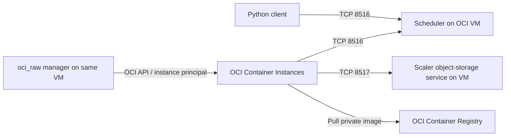

# OpenGRIS and the Python packages

[Back to README](../README.md)

### The OpenGRIS packages

The three libraries address different parts of a parallel application:

| Component | Python distribution / import | Role | Example use |
|---|---|---|---|
| [Scaler](https://github.com/finos/opengris-scaler) | `opengris-scaler` / `scaler` | Executes distributed tasks through a client, scheduler, workers, and worker managers. The client submits work and retrieves results through futures. | Submit independent Monte Carlo partitions to workers running in OCI Container Instances. |
| [ParGraph](https://github.com/finos/opengris-pargraph) | `pargraph` / `pargraph` | Expresses calculations as dependency graphs. Its graph-building decorators and graph engine describe which tasks can run concurrently and which need earlier results. | Prepare market data, run independent valuations, then aggregate results once their inputs are ready. |
| [Parfun](https://github.com/finos/opengris-parfun) | `parfun` / `parfun` | Adds function-level parallelism using the `@parallel` decorator. The application defines how to split inputs and combine outputs in a map/reduce pattern. | Split a large input collection into batches, process the batches in parallel, and combine the results. |

**Scaler handles execution; ParGraph expresses dependencies; Parfun expresses how to split and combine function work.** ParGraph and Parfun can be used with suitable execution backends, including Scaler. They are optional application-level tools: a client can submit tasks directly to Scaler without either library.

For example, a Monte Carlo application can submit each independent partition directly with `Client.submit()`, use ParGraph to connect preparation, simulation, and aggregation stages, or use Parfun to describe partitioning and reduction around a function. These are application design choices rather than a requirement to install all three packages.

### How this repository runs OpenGRIS on OCI

This quickstart uses **Scaler directly**, with its `oci_raw` worker manager. The command-line examples use Scaler directly; the bundled notebook examples also use ParGraph and Parfun. Their dependencies are installed on the VM and in worker images.

On Oracle Cloud Infrastructure (OCI), Scaler's **`oci_raw` worker manager** can create and delete **OCI Container Instances** as workload demand changes. One Compute VM runs the scheduler, the worker manager, and Scaler's object-storage service. Worker processes run inside the container instances and connect back to that VM over the private network. This setup needs no Kubernetes cluster. Scaler's object-storage service is its own process on TCP 8517; it is distinct from OCI Object Storage buckets.

This repository guides you from a new OCI VM to a working grid, then runs the European, Asian, digital, barrier, and market-risk examples from [oci-monte-carlo-quickstart](https://github.com/dezma/oci-monte-carlo-quickstart). It uses VM instance principals for OCI authentication and private OCIR images. It is a single-VM demonstration, with local result files; it does not configure scheduler high availability, authentication between Scaler clients/workers, or durable recovery after scheduler failure.

Next: [Installation](installation.md).
